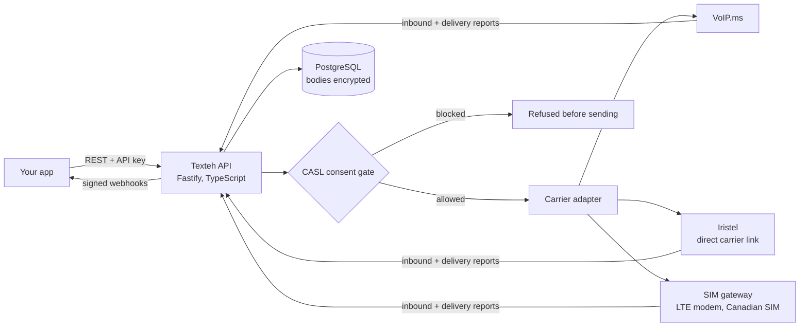

# Texteh (sovereign-sms)

**A Canadian-sovereign SMS API with a Twilio-shaped REST interface.**
Built so that no US company sits anywhere in the chain that carries a message.

> This is a public showcase. The source code lives in a private repository. This README
> explains what the system does, how it is built, and why.

---

## The problem

Most "Canadian SMS" providers sell *data residency*: your messages sit in a Montreal data
centre, but that data centre belongs to a US corporation, so the data can still be reached
under the US CLOUD Act. Residency is not the same as sovereignty.

Texteh aims for **sovereignty**. Every vendor in the stack (carrier, compute, DNS, backups,
and alerting) was chosen so that no US entity is in the contracting chain. Where a gap
remains, it is documented rather than hidden.

---

## What it does

- **Sends and receives SMS** on Canadian long codes.
- **Verifies phone numbers by one-time code (OTP)**, with hashed codes, attempt caps, and
  protection against SMS pumping fraud.
- **Builds in CASL compliance**: STOP, START, and HELP are enforced *before* a message is sent,
  in English and French, with an append-only record of every consent change.
- **Supports idempotency keys**, so a retried request cannot double-send or double-charge.
- **Sends signed webhooks** (HMAC, with replay protection) for inbound messages and delivery
  reports.
- **Encrypts message bodies at rest** (AES-256-GCM) and deletes them automatically after a
  retention window.
- **Returns bilingual errors.** Every error carries both an English and a French message.

---

## Architecture

### Pluggable carriers, each one declaring its own sovereignty
The right carrier may change over time, so the code does not care which one is underneath.
Switching is a single environment variable.

| Adapter | Status |
|---|---|
| Mock | For tests, and for building before any contract exists |
| VoIP.ms | Implemented (REST, inbound callbacks) |
| SIM gateway | Implemented: an LTE modem on a Canadian SIM, driven by AT commands and a PDU codec (GSM-7 and UCS-2, long messages, delivery reports) |
| Iristel | Stub, waiting on a wholesale agreement |

Each adapter declares a **sovereignty profile** in code, including whether the vendor has
confirmed its upstream chain *in writing*. Until they have, the service warns at startup and
publishes that fact at `/.well-known/sovereignty`. An unverified claim cannot pass for a
verified one.

### Stack
| Layer | Choice |
|---|---|
| Language | TypeScript on Node.js 22, compiled for production |
| HTTP | Fastify |
| Database | PostgreSQL |
| Hosting | FullHost, Montreal (Canadian-owned), on Debian 13 |
| Edge | Caddy |
| Backups | Nightly `pg_dump`, encrypted with `age` to a key the server does not hold |
| Alerting | Health, disk, backup age, certificate expiry, and modem link. Alerts carry metadata only, never message bodies or phone numbers |

---

## Engineering decisions worth knowing about

- **CASL fails closed.** A message counts as commercial unless the sender says otherwise, so
  the consent gate applies by default.
- **The server cannot read its own backups.** Backups are encrypted to an external public key,
  and a restore script proves they can be recovered on a separate machine.
- **The installer is hardened and opinionated.** It provisions a locked-down systemd service,
  a firewall, and timers, and it refuses operating systems that no longer get security updates.
  It also removes snapd on Ubuntu, because an unattended third-party update channel is a risk
  on a host that holds message plaintext.
- **Skipped tests cannot pass for green.** The full test run turns any skipped suite into a
  failure, so a missing database or tool cannot make a short run look complete.
- **Vendor diligence is written down.** A written architecture and vendor analysis covers each
  layer, the remaining sovereignty gaps, a cost model, and a regulatory checklist.

## Testing
Unit and integration tests cover phone number handling, SMS segmentation, encryption, OTP
brute-force resistance, webhook signatures and replay, CASL keyword edge cases, auth scopes,
idempotency, the consent gate, inbound and delivery-report handling, retention, rate limiting,
log redaction, the modem protocol (against a fake modem), and the deploy and backup scripts.

---

## Status

Version 0.1. Built for low-volume, single-operator use. Deployed on a Canadian VPS.

## About

Built by **Kirko Papajanis** under [KRROP](https://krrop.com).
More about me at [k17z.com](https://k17z.com).
